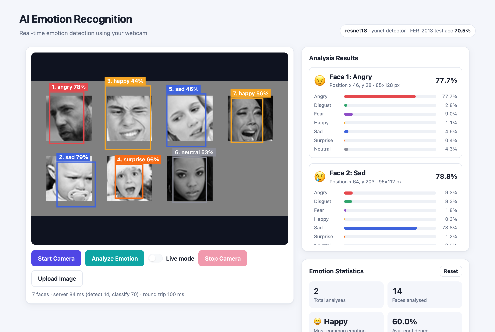
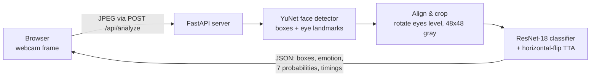
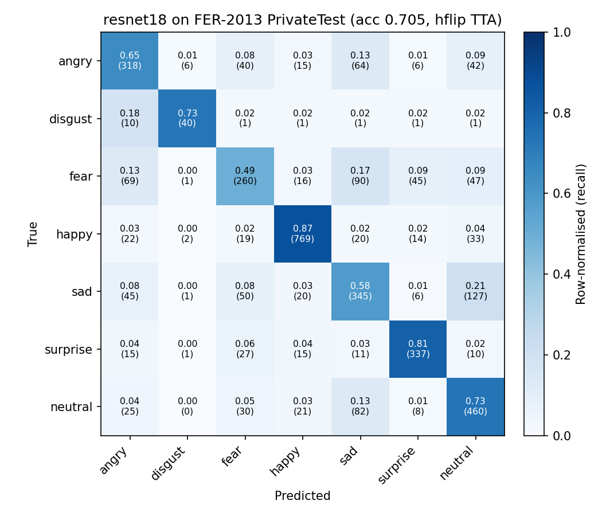

# AI Emotion Recognition

Real-time facial expression recognition from a webcam. A face detector finds every face in the frame, each face is aligned and classified into one of seven expressions by a CNN trained on FER-2013, and a small web app shows the results live.

This is a rebuilt, extended version of an earlier course project whose code was lost. The new version adds a proper training and evaluation pipeline, a stronger model, multi-face support and reproducible metrics.

**Result:** ResNet-18 (ImageNet-pretrained, fine-tuned) reaches **70.5% accuracy and 0.698 macro-F1** on the FER-2013 PrivateTest split. It runs at about 7 ms per face on a laptop CPU.


<!-- Placeholder: add a webcam screenshot at docs/screenshots/demo.png -->

---

## Features

- **Seven expressions:** angry, disgust, fear, happy, sad, surprise, neutral.
- **Multi-face:** every detected face gets its own box, label and probability bars.
- **Face alignment:** the YuNet detector also returns eye landmarks. Each face is rotated so the eyes are level before classification.
- **Webcam demo:** Start Camera / Analyze Emotion / Stop Camera, plus a **live mode** that analyses about 4 frames per second with temporal smoothing. You can also upload an image when no webcam is available.
- **Session statistics:** total analyses, faces analysed, most common emotion, average confidence and the emotion distribution.
- **Reproducible:** fixed splits, seeded training, and saved configs, metrics and plots in [`results/`](results/).

## Architecture



| Stage | Details |
|---|---|
| Face detection | [YuNet](https://github.com/opencv/opencv_zoo/tree/main/models/face_detection_yunet) (OpenCV `FaceDetectorYN`, 230 KB ONNX). Falls back to the Haar cascade bundled with OpenCV if the ONNX file is missing. |
| Alignment | One affine warp rotates the face so the eyes are level, scales it and crops it to 48×48 grayscale. The crop is 0.9× the detector box side, chosen on the validation split (see [Pipeline evaluation](#pipeline-evaluation-detector--classifier)). |
| Classifier | torchvision ResNet-18 with ImageNet weights. The 48×48 face is upsampled to 96×96 and replicated to 3 channels inside the model, and the final layer is replaced with dropout plus a 7-way linear layer. Resizing and normalisation live in the model, so every architecture takes the same 1×48×48 input. |
| Inference | Softmax averaged over the face and its mirror image (horizontal-flip test-time augmentation), on CPU. |
| Web app | FastAPI backend and a plain HTML/CSS/JS frontend, with no build step. The server keeps no state, and session statistics live in the browser. |

## Dataset

[FER-2013](https://www.kaggle.com/datasets/msambare/fer2013) (Goodfellow et al., 2013) contains 35,887 grayscale 48×48 face images in 7 classes. This project uses the three original splits:

| Split | Used as | Images |
|---|---|---|
| Training | training | 28,709 |
| PublicTest | validation (model selection, crop-margin tuning) | 3,589 |
| PrivateTest | **test** (reported once, never used for decisions) | 3,589 |

The classes are strongly imbalanced. In the training split, *happy* has 7,215 images and *disgust* only 436 (16× fewer).

`scripts/download_data.py` fetches the dataset from a [Hugging Face mirror](https://huggingface.co/datasets/Aaryan333/fer2013_train_publicTest_privateTest) that keeps the original splits. Its per-class counts match the official release. The images are cached as `.npz`, and the dataset is not stored in this repository.

## Training

| Setting | Value |
|---|---|
| Optimiser | SGD, Nesterov momentum 0.9, weight decay 5e-4, batch size 128 |
| Schedule | 30 epochs: 2-epoch linear warm-up to lr 0.01, then cosine decay to 0 |
| Loss | Cross-entropy with label smoothing 0.1 and class weights |
| Class weighting | Square-root inverse frequency, normalised to mean 1 (disgust 2.44, happy 0.60). Full inverse frequency over-weights *disgust* by about 9×. |
| Augmentation | Random resized crop (scale 0.8–1.0), horizontal flip, rotation ±10°, translation ±5%, brightness/contrast jitter ±0.3, random erasing (p = 0.25) |
| Model selection | Best validation (PublicTest) accuracy |
| Hardware | Apple M1 (8 GB) via PyTorch MPS, about 75 s per epoch, about 37 min per run |

The exact configuration of each run is saved in `results/<model>/config.json`, and the per-epoch history in `history.json`.

## Results

All numbers below were measured on the FER-2013 **PrivateTest** split (3,589 images) with the checkpoint that scored best on validation. "TTA" means averaging predictions over the face and its mirror image.

| Model | Params | Pretrained | Test acc | Test acc (TTA) | Macro-F1 (TTA) | CPU latency / face |
|---|---:|:---:|---:|---:|---:|---:|
| Small CNN (VGG-style, from scratch) | 4.8 M | – | 67.0% | 68.4% | 0.653 | 4.3 ms |
| **ResNet-18 (fine-tuned, 96 px input)** | 11.2 M | ImageNet | 70.1% | **70.5%** | **0.698** | 7.2 ms |

CPU latency is the median single-face forward pass on the M1 CPU, without TTA (see `evaluate.py`).

For context, human accuracy on FER-2013 is estimated at about 65 ± 5% (Goodfellow et al., 2013), because many images are ambiguous or noisily labelled. Strong single models in the literature reach about 73% (e.g. 73.28% for a tuned VGG in Khaireddin & Chen, 2021).

### Per-class results (ResNet-18, TTA)

| Emotion | Precision | Recall | F1 | Test images |
|---|---:|---:|---:|---:|
| Angry | 0.631 | 0.648 | 0.639 | 491 |
| Disgust | 0.784 | 0.727 | 0.755 | 55 |
| Fear | 0.609 | 0.492 | 0.545 | 528 |
| Happy | 0.897 | 0.875 | 0.886 | 879 |
| Sad | 0.563 | 0.581 | 0.572 | 594 |
| Surprise | 0.808 | 0.810 | 0.809 | 416 |
| Neutral | 0.639 | 0.735 | 0.684 | 626 |

<p align="center">
  
</p>

What the confusion matrix shows:

- *Happy* and *surprise* are the easiest classes.
- *Fear* is the hardest class (recall 0.49). It is most often confused with *sad* (17%) and *angry* (13%).
- *Sad* is often predicted as *neutral* (21%). Both are low-arousal expressions without a strong mouth shape.
- Class weighting helps *disgust*, the rarest class: it still reaches 0.73 recall from only 436 training images.

Training curves: [`results/resnet18/training_curves.png`](results/resnet18/training_curves.png). Validation accuracy levels off after about 20 epochs while training accuracy keeps rising to 83%, so more regularisation or data would likely help more than more epochs.

### Pipeline evaluation (detector + classifier)

The numbers above use FER-2013's own crops. In the app, faces are instead cut out from YuNet boxes. `scripts/pipeline_eval.py` measures that gap. It upscales each test image 4× (to about 192 px, a typical webcam face size), pads it, runs the detector and classifies the crop exactly as the server does.

| | Value |
|---|---|
| Faces found by YuNet (test) | 3,329 / 3,589 (92.8%) |
| Accuracy on those faces using the dataset crops | 70.7% |
| Accuracy on those faces using the **full pipeline** (detect, align, crop at 0.9×) | **68.6%** |

The crop margin was tuned on the validation split only. Validation accuracy by margin: 0.85× → 67.4%, 0.9× → 67.3%, 1.0× → 66.4%, 1.25× → 59.6%. FER-2013 faces are tightly cropped, so a crop slightly inside the detector box matches the training data best. This experiment has a limitation: the padding around upscaled FER images is synthetic, so real webcam frames may behave somewhat differently.

## Setup

Requires Python 3.10+. The results above were produced with Python 3.14 and PyTorch 2.12.

```bash
git clone https://github.com/moshiurdev/AI-Emotion-Detection.git
cd AI-Emotion-Detection
python3 -m venv .venv
source .venv/bin/activate
pip install -r requirements.txt
```

### Get the data and the face detector

```bash
python scripts/download_data.py              # FER-2013 (~135 MB) + YuNet face detector
python scripts/download_data.py --skip-data  # face detector only (enough to run the demo)
```

### Pretrained weights

Model weights (`fer_resnet18.pt`, 43 MB) are not stored in git. Either download `fer_resnet18.pt` from this repository's [Releases page](../../releases) and place it at `checkpoints/fer_resnet18.pt`, or train it yourself (next section).

## Usage

### Train

```bash
python train.py --arch resnet18 --input-size 96 --epochs 30 --name resnet18
python train.py --arch small_cnn --epochs 30 --name small_cnn      # baseline
mkdir -p checkpoints && cp runs/resnet18/best.pt checkpoints/fer_resnet18.pt
```

Training picks CUDA, Apple MPS or CPU automatically. Use `--limit 512 --epochs 1` for a quick smoke test.

### Evaluate

```bash
python evaluate.py --checkpoint checkpoints/fer_resnet18.pt --out results/resnet18
python scripts/pipeline_eval.py --checkpoint checkpoints/fer_resnet18.pt --split val      # margin sweep
python scripts/pipeline_eval.py --checkpoint checkpoints/fer_resnet18.pt --split test --margins 0.9
```

### Run the web demo

```bash
python -m app.server --checkpoint checkpoints/fer_resnet18.pt
# open http://127.0.0.1:8000
```

Click **Start Camera** and allow camera access, then click **Analyze Emotion** or turn on **Live mode**. Browsers only allow webcam access on `localhost` or HTTPS. Without a webcam, use **Upload Image**. `python scripts/make_demo_image.py` builds a 7-face test image from FER-2013 test faces at `data/demo/faces.jpg`.

API:

| Endpoint | Description |
|---|---|
| `POST /api/analyze` | multipart field `image`. Returns faces (box, emotion, confidence, 7 probabilities), image size and timings in ms. |
| `GET /api/info` | model, detector and test metrics |

### Tests

```bash
pytest
```

The tests cover model shapes, class weighting, augmentation, crop alignment, the detector and the API. They use a tiny randomly initialised checkpoint, so they run without the dataset or trained weights. One test also checks that the headline numbers in this README match `results/resnet18/metrics.json`.

## Project structure

```
├── fer/                    # library code
│   ├── __init__.py         # class names, input size
│   ├── data.py             # FER-2013 dataset, augmentation, class weights
│   ├── models.py           # ResNet-18 / MobileNetV3 wrappers, small CNN baseline
│   ├── face_detector.py    # YuNet (default) and Haar multi-face detection
│   ├── pipeline.py         # align + crop + classify; used by the app
│   └── utils.py            # device selection, seeding, checkpoint I/O
├── app/
│   ├── server.py           # FastAPI app
│   └── static/             # index.html, app.js, style.css
├── scripts/
│   ├── download_data.py    # FER-2013 + YuNet download
│   ├── pipeline_eval.py    # detector + classifier evaluation, margin sweep
│   └── make_demo_image.py  # multi-face test image
├── results/                # metrics.json, confusion matrices, curves, configs (committed)
├── tests/                  # pytest suite
├── train.py
├── evaluate.py
└── requirements.txt
```

Git-ignored: `data/` (dataset), `runs/` (training outputs), `checkpoints/` and `models/` (weights).

## Limitations and ethics

- FER-2013 labels describe **visible facial expressions**, not what a person actually feels. The same expression can mean different things in different contexts and cultures.
- The dataset is low-resolution, grayscale and mostly frontal, and its demographic balance is not documented, so accuracy may differ across groups of people and in real-world conditions.
- Do not use this for decisions about people (hiring, surveillance, grading). It is a learning and demo project.
- The demo processes frames in memory and stores nothing.

## Possible next steps

- Ablations, which have not been run yet: no class weighting vs. square-root vs. full inverse weighting, and input size 96 vs. 112.
- Training on cleaner labels (FER+), or adding RAF-DB / AffectNet to improve real-world robustness.
- Exporting to ONNX and running in the browser (onnxruntime-web) for a server-free demo.

## References

- I. Goodfellow et al., *Challenges in Representation Learning: A report on three machine learning contests*, ICONIP 2013. (FER-2013)
- Y. Khaireddin, Z. Chen, *Facial Emotion Recognition: State of the Art Performance on FER2013*, arXiv:2105.03588, 2021.
- K. He et al., *Deep Residual Learning for Image Recognition*, CVPR 2016.
- W. Wu et al., *YuNet: A Tiny Millisecond-level Face Detector*, Machine Intelligence Research, 2023.

## License

[MIT](LICENSE). FER-2013 and YuNet are distributed under their own terms and are downloaded separately.
